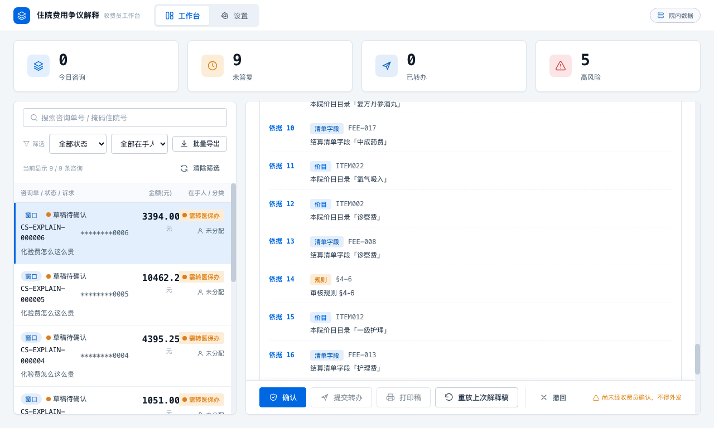
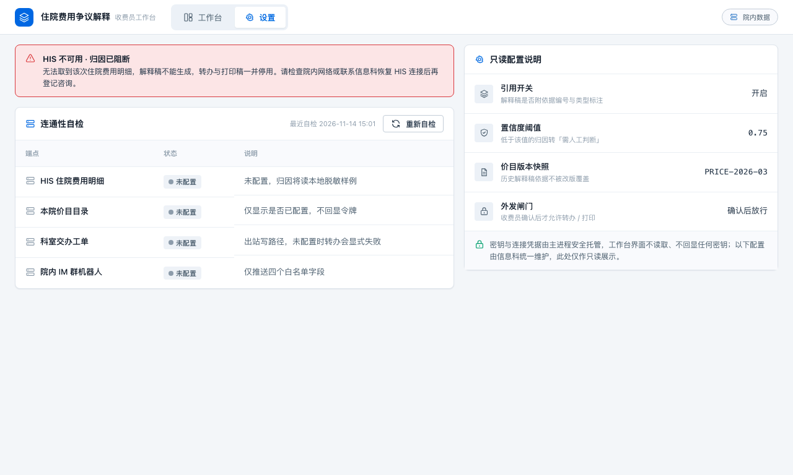

# 住院费用争议解释系统

> 收费员把家属对费用的一句疑问粘进窗口，系统按这次住院的费用明细逐条说清「这笔是什么、为什么不能报医保」，把说不清的自动分流给医保办；收费员确认后打印给家属，家属事后再问，窗口直接调出上次那份解释稿。

住院收费处窗口上最耗人的一件事不是算账，是**把账讲给家属听**：家属说「上次多算了 3200」，
收费员要在几分钟内翻出这次住院的费用明细、翻本院价目表确认医保属性、再翻医保结算口径，
逐条写一份家属看得懂的说明——大部分时候还要查同一个问题到底问没问过、上次怎么答的。

本系统把这段手工活接成一条闭环：**家属一句疑问 → 带引用依据的逐条解释稿 → 争议分类 →
收费员确认 → 打印给家属 / 转交医保办**。解释稿里的每一句「为什么这样算」都能点开看依据
（本院价目编码、医保结算清单字段号、医保违规负面清单条目号），家属事后再来问，窗口调出上次那份，
不重新生成、不改口径。

## 适用场景 / 目标岗位

| 岗位 | 什么时候用 | 得到什么 |
|------|------------|----------|
| 住院收费处收费员 | 家属在出院结算 / 中途结算窗口当面问费用，或打电话、在线上留言问同一笔 | 逐条对得上号的解释稿，每条能点开看依据；一份争议分类单，标明哪条当场能讲、哪条要转医保办 |
| 住院服务中心 | 咨询超时还没答复，要弄清还剩哪些没答、归谁 | 未答复清单与升级记录，超时项单独标出来 |
| 医保办 | 咨询被判「需转医保办」，需要依据才能办 | 一张带引用依据的交办单（重复提交不重复建单），回执自动写回咨询单状态 |
| 财务科 | 月度核对争议处理情况与口径引用 | 咨询台账与引用留痕导出包（CSV / JSON），能对到每一句解释依据哪条价目、哪条清单字段、哪个模型版本 |

## 能力要点

- **家属一句疑问，直接出逐条解释稿**：把「上次多算了 3200」这类口述诉求对上这次住院的具体明细行，每条写清「这笔是什么 / 为什么这样算 / 依据编号」。
- **依据可点开，不是一句「按政策规定」**：每条解释只允许引用三类依据——本院价目条目、医保结算清单字段、医保违规负面清单条目，引用编号按首次出现顺序生成。
- **说不清的自动分流**：院内核对 / 需转医保办 / 需人工判断三值分类，「需人工判断」的条目单独成组，既不打印也不转办，等人来接。
- **收费员确认是唯一放行闸门**：模型与规则产出的永远是草稿，未确认不打印、不提交交办工单、不推送到院内 IM。
- **转办带幂等键、回执自动写回**：同一笔争议重复提交只产生一张工单，工单回执回来后咨询单状态自动置为「已转办」并记工单号。
- **家属事后再来问，不用重来一遍**：已答复咨询可原样重放当时的解释稿与引用清单（含当时的价目版本与口径版本快照），价目改版也不改写历史依据。

## 快速开始

### 依赖

- Node.js ≥ 22.5 + npm ≥ 10（本机 Node 22.22.2 验证；持久化用 Node 内置 `node:sqlite`，无需原生编译；TS 由 Node 类型剥离直接执行）
- 桌面程序需要 macOS 12+ / Windows 10+ / 主流 Linux 桌面环境（Electron 38，内置 Node 22）

### 安装

```bash
cd inpatient-bill-dispute
npm install          # 安装依赖（Electron、zod、dotenv、TypeScript、Vite）
```

### 配置

凭据一律从环境变量读，仓库里不放任何真实地址与密钥。

```bash
cp .env.example .env   # 填入本院 HIS / 价目 / 工单 / IM 的真实地址与令牌，以及模型网关配置
```

先自检配置是否齐备（只显示「是否已配置」，不回显取值）：

```bash
npm run cli -- doctor
```

### 构建与验证

```bash
npm run build            # TypeScript 编译 + 字典/样例资产复制 + Vite 打包渲染层
npm run typecheck        # 严格类型检查（含 noUncheckedIndexedAccess）
npm test                 # 49 项单元与契约测试（Node 原生 test runner）
bash scripts/verify.sh   # 一条命令跑通构建 → 使用 → 验证
```

### 主命令速查

```bash
npm start                    # 桌面程序（窗口 + 托盘常驻），日常出稿走这里
npm run capture              # 固定脱敏样例采集三张真实截图 + CLI 输出
npm run cli -- doctor        # 凭据位配置状态（缺必填项非 0 退出）
npm run cli -- dict:check    # 口径字典完整性自检
npm run cli -- ledger --seed # 导入种子台账并分页列出
npm run cli -- explain --encounter ZY2026000001 --text "化验费怎么这么贵"
npm run cli -- cases:run     # 官方 8 条结算清单质控用例跑批
npm run cli -- export        # 导出引用留痕包（CSV + JSON）
```

## 命令 / API / 配置说明

### 关键配置项

| 配置项 | 默认值 | 说明 |
|--------|--------|------|
| `OPENAI_BASE_URL` | 无 | 模型网关端点，OpenAI-compatible；医院自建端点、本地模型与云服务共用同一配置面 |
| `OPENAI_API_KEY` | 无 | 模型网关访问令牌（敏感项，不回显） |
| `OPENAI_MODEL` | 无 | 归因使用的模型名，会写进每轮留痕供复核 |
| `OPENAI_TIMEOUT_MS` | `30000` | 模型调用超时（毫秒） |
| `OPENAI_MAX_RETRIES` | `1` | 最大重试次数，仅超时与 5xx 可重试 |
| `HIS_BASE_URL` | 无 | HIS 住院费用明细地址 |
| `HIS_API_TOKEN` | 无 | HIS 访问令牌（敏感项，不回显） |
| `PRICING_BASE_URL` | 无 | 本院价目目录地址 |
| `PRICING_API_TOKEN` | 无 | 价目目录访问令牌（敏感项，不回显） |
| `WORKORDER_BASE_URL` | 无 | 科室交办工单地址 |
| `WORKORDER_TOKEN` | 无 | 工单系统访问令牌（敏感项，不回显） |
| `IM_WEBHOOK_URL` | 无 | 院内 IM 群机器人地址（可选，推送通道） |
| `ATTRIBUTION_MIN_CONFIDENCE` | `0.65` | 归因置信度阈值，低于此值判「需人工判断」 |
| `ATTRIBUTION_CONFIDENCE_MARGIN` | `0.05` | 互斥分类置信度差落入该带宽即拒答，保留原始分数供人工参考 |
| `EXPLANATION_MAX_CHARS` | `1200` | 解释稿字数上限，超出触发重写与低争议项裁剪 |
| `CITATIONS_ENABLED` | `true` | 引用总开关，关闭时正文不出现裸编号 |
| `RECONCILIATION_TOLERANCE_CENTS` | `0` | 金额勾稽容差（按分计） |
| `WORKORDER_MAX_RETRIES` / `WORKORDER_BACKOFF_MS` | `3` / `100` | 工单 5xx / 超时重试次数与退避基数（毫秒） |
| `SLA_COUNTER_MINUTES` / `SLA_PHONE_MINUTES` / `SLA_ONLINE_MINUTES` | `30` / `60` / `240` | 分渠道超时升级阈值（分钟） |
| `LEDGER_DB_PATH` | `data/ledger.sqlite` | 本地台账路径；留空即用默认值 |

### CLI 子命令 / 接口端点

| 命令或路径 | 用途 | 关键参数 |
|------------|------|----------|
| `cli doctor` | 列出全部凭据位配置状态，缺必填项时非 0 退出 | 无 |
| `cli help` / `cli version` | 帮助与版本号 | 无 |
| `cli ledger` | 咨询台账分页列出（咨询编号、渠道、掩码住院号、状态、金额、创建时间） | `--seed [文件]`、`--status`、`--from`、`--to`、`--limit`、`--offset` |
| `cli dict:check` | 校验口径字典装载完整性，缺项报「依据缺失」并非 0 退出 | `--inject-missing <编号>`（人为删编号验证失败路径） |
| `cli explain` | 对一次住院跑归因，产出带引用解释稿与争议分类 | `--encounter`、`--text`、`--operator` |
| `cli export` | 导出引用留痕包（同时产出 CSV 与 JSON） | `--from`、`--to`、`--status`、`--limit` |
| `GET {HIS_BASE_URL}/api/v1/inpatient-bills/{encounter_no}/details` | 读一次住院的费用明细与各支付口径 | `Authorization: Bearer $HIS_API_TOKEN` |
| `GET {PRICING_BASE_URL}/api/v1/price-items` | 读本院价目目录（带版本号） | `Authorization: Bearer $PRICING_API_TOKEN` |
| `POST {WORKORDER_BASE_URL}/api/v1/consultations/{consultation_no}/handoff` | 提交科室交办工单 | `Authorization: Bearer $WORKORDER_TOKEN`、`Idempotency-Key: sha256(encounter_no\|reason_code\|item_code)` |
| `POST $IM_WEBHOOK_URL` | 院内 IM 群机器人推送（仅白名单字段） | 白名单：咨询编号、收费项目编码、争议分类、解释稿编号 |

全部 14 个子命令、参数与退出码见 `docs/cli.md`。

### 错误与降级

| 场景 | 表现 | 处理方式 |
|------|------|----------|
| 模型网关不可达 / 超时 | 解释稿标「待人工撰写」 | 只出确定性产物（明细清单 + 规则命中 + 勾稽结论），咨询单**保持草稿待确认**，绝不自动置为已答复 |
| HIS 不可用 | 拉不到明细 | 界面提示并阻断归因，不拿本地样例冒充真实数据 |
| 价目编码未命中 | 该行无依据 | 标「依据缺失 → 需人工判断」，不编造依据、不做模糊猜测 |
| 住院号命中多条住院记录 | 无法确定是哪次住院 | 抛歧义错误，要求人工选定，禁止自动取第一条 |
| 交办工单返回 5xx | 转办未成功 | 指数退避重试（≤3 次），仍失败则标「转办失败待重试」并写错误码，不静默吞掉 |
| 交办工单返回 4xx | 请求本身有问题 | 不重试，直接落失败原因 |
| 解释稿命中禁语（承诺报销、断定违规、诊断建议等） | 稿子被标不可外发 | 拒发并指出命中条目，提示重写，不自动改写后放行 |
| 未确认即触发外发 | 打印 / 转办 / IM 推送被拒 | 返回统一错误码「尚未经收费员确认，不得外发」 |
| 已确认但含需人工判断条目 | 外发仍被拒 | 单独返回「该咨询不满足外发条件，不得外发」，避免误报成未确认 |

### 对接现有系统

| 对端 | 方向 | 协议与字段 | 凭据来源 |
|------|------|------------|----------|
| HIS 住院费用 | 读 | HTTP GET，明细行含行号、收费项目编码、金额、医保费用类别、费用类目、发生日期、科室编码；结算含各支付口径 | `HIS_BASE_URL` / `HIS_API_TOKEN` |
| 本院价目目录 | 读 | HTTP GET，返回带版本号的价目项集合，按收费项目编码精确匹配 | `PRICING_BASE_URL` / `PRICING_API_TOKEN` |
| 科室交办工单 | 写 | HTTP POST + `Idempotency-Key`，body 含咨询编号、住院号、目标科室、争议分类、依据清单、解释稿摘要、提交人 | `WORKORDER_BASE_URL` / `WORKORDER_TOKEN` |
| 院内 IM 群机器人 | 写 | HTTP POST markdown 消息，字段白名单化，不含金额与身份信息 | `IM_WEBHOOK_URL` |

本地口径层（医保结算清单字段字典、医保违规负面清单规则、金额勾稽常量）来自官方口径文件，
带版本号与生效日期装载；**价目改版后，历史解释稿的依据指向当时的版本快照，不被改写**。

## 典型场景

### 场景 1：收费员在结算窗口当场把一笔疑问讲清

1. 家属说「上次多算了 3200」，收费员把这句话粘进窗口，填上这次住院号；
2. 点「归因」，系统拉这次住院的费用明细与本院价目，逐条产出解释稿与争议分类；
3. 收费员核对后点「确认」，打印稿落到 `outbox/`，当场给家属。

```bash
# 等价 CLI 备选
npm run cli -- explain --encounter ZY2026000006 --text "化验费怎么这么贵"
npm run cli -- confirm CS-EXPLAIN-000006 && npm run cli -- print CS-EXPLAIN-000006
```

### 场景 2：家属问的这条医保属性拿不准，转给医保办

1. 归因结果里有一条被判「需转医保办」，解释稿里标出依据是医保支付范围外；
2. 收费员确认后点「提交转办」，系统带幂等键提交交办工单，不会重复建单；
3. 工单回执回来，咨询单状态自动置为「已转办」并记工单号，住院服务中心看得见还剩哪些没结。

```bash
# 等价 CLI 备选：提交后回执写回咨询单状态
npm run cli -- explain --encounter ZY2026000006 --text "这药为什么不能报医保"
npm run cli -- confirm CS-EXPLAIN-000006 && npm run cli -- handoff CS-EXPLAIN-000006
```

### 场景 3：住院服务中心查还剩哪些没答

1. 打开台账视图，按「未答复 + 超时」筛选，按在手人分组；
2. 超时项自动升级给住院服务中心，超时口径按渠道可配（窗口当面与线上留言时限不同）；
3. 家属事后再来问，窗口按咨询编号调出上次的解释稿与引用清单，原样重放，不重新生成。

```bash
# 等价 CLI 备选
npm run cli -- ledger --status pending_reply
npm run cli -- sla:scan --at 2026-11-14T12:00:00
```

### 场景 4：财务科导出本月引用留痕给内审

台账按时间范围筛选本月已答复 / 已转办咨询，点「批量导出」；CSV 中文表头可直接用 Excel 打开，JSON 含引用清单与版本快照。

```bash
npm run cli -- export --from 2026-11-01 --to 2026-11-30
```

### 场景 5：信息科核对口径字典与官方质控用例

在设置页看「连通性自检」与只读配置说明，再用官方 8 条结算清单质控用例跑批；人为破坏某条规则须看到失败退出码，确认校验不是摆设。

```bash
npm run cli -- dict:check && npm run cli -- cases:run
```

### 场景 6：收费班组长按在岗容量派单

多通道诉求收拢进同一张咨询单后，按争议类型绑定队列，再按在岗容量上限轮询取件；两名助手并发抢同一条只产生一条派单记录。

```bash
npm run cli -- intake --channel counter --encounter ZY2026000001 --text "床位费是不是算重了"
npm run cli -- assign CS202611140010   # 换成上一步输出的咨询编号
```

### 场景 7：家属事后再来问，原样调出上次那份

按咨询编号点「重放上次解释稿」，界面载入当时的解释稿正文、引用清单与版本快照，不重跑模型、不新增归因轮次、不改写历史依据。

```bash
npm run cli -- replay CS-EXPLAIN-000001
```

## 输出样例

四类产物（脱敏解释稿、争议分类单、交办工单请求体、台账导出列头）的完整样例见 `docs/examples.md`；CLI 真实输出见 `docs/screenshots/04-cli-explain.txt`，界面实测见下方三张截图。
产物统一落 `outbox/`：`explanation-<咨询编号>.md`、`classification-<咨询编号>.json`、`print-<咨询编号>.html`、`audit-export.csv` / `.json`。

## 概念 / 实测对照

### 视觉目标

视觉目标见 `docs/concepts/visual-target.md`：起始态（托盘点 + 两栏窗口 + 空态）、
首个可用瞬间（逐项解释稿 + 顶部四个汇总数字）、成形态（左侧状态流水线 + 引用计数 + 待打印稿角标），
以及配色（底 `#F5F7FA`、主色 `#1F6FEB`、分类点绿 `#17A673` / 琥珀 `#D98A00` / 红 `#D64545`）、
字体层级（PingFang SC 正文 13px，数字与编码等宽右对齐）与必须可达的约束。本环境无图像生成能力，
只保留结构化视觉目标卡，不伪造概念图。

### 实测证据






CLI 通道真实输出：[docs/screenshots/04-cli-explain.txt](docs/screenshots/04-cli-explain.txt)。

> **诚实标注**：上面是视觉目标（设计意图），下面才是真实实测。目标是「一屏容 8 条明细行、分类点色块、等宽数字」的密度，
> 实际渲染以采集到的真实截图为准；不生成「事后效果图」抹平差距，也不用设计稿冒充实测。

## 架构与数据流

```
   窗口当面 / 电话 / 线上留言
              │
              ▼
   ┌──────────────────────────────┐
   │  咨询单（多通道收拢 · 六态）  │  待答复 → 草稿待确认 → 已答复 / 已转办 → 已关闭
   └──────────────┬───────────────┘  未确认态可撤回
                  ▼
   ┌──────────────────────────────┐        ┌──────────────────────────┐
   │  归因引擎                     │        │  守门规则层               │
   │  质疑点抽取 → n:m 归并 →      │◀──────▶│  负面清单 §4 七条         │
   │  带引用解释稿 + 争议分类      │        │  金额勾稽 / 属性核验      │
   └──────────────┬───────────────┘        └────────────┬─────────────┘
                  │                                     │
                  │            ┌────────────────────────▼───────────┐
                  │            │  口径字典层（版本化装载）          │
                  │            │  结算清单字段 / 规则条目 / 勾稽常量 │
                  │            └────────────────────────┬───────────┘
                  ▼                                     ▼
   ┌──────────────────────────────────────────────────────────┐
   │  收费员确认（唯一放行闸门 · 未确认一律拒绝外发）            │
   └───────────┬───────────────────┬──────────────────┬────────┘
               ▼                   ▼                  ▼
          家属可读打印稿      科室交办工单（幂等）    院内 IM 推送
                                  │                  （白名单字段）
                                  ▼
                          工单回执 → 写回咨询单状态「已转办」
   每一轮归因落一行留痕：引用清单 + 模型名与版本 + 守门命中 + 耗时 + 掩码住院号
```

### 关键不变量

- **确认闸门不可绕过**：打印稿、交办工单、IM 推送三条通道统一校验确认时间与状态；未确认一律拒绝，不静默放行。
- **模型输出恒为草稿**：模型不写 HIS 费用、不改结算清单、不自动提交转办单、不推进咨询状态；不可达时只出确定性产物。
- **引用只有三类**：价目条目、结算清单字段、负面清单条目；无依据的解释不产生，价目未命中标「依据缺失 → 需人工判断」。
- **三重绑定缺一即拒**：住院号 + 明细行号 + 收费项目编码缺任一项，不进入解释稿。
- **幂等与不静默改数据**：转办带幂等键，重复提交只建一张单；失败落错误码与重试标记，不假装已提交；非法状态跃迁被拒后原状态不变。

## 安全与合规边界

- 解释稿只描述**费用口径与依据**，不输出诊断或治疗建议，不代签、不自动签名。
- 姓名 / 证件号 / 床号 / 电话 / 住址在进入模型前统一替换为占位；本地日志与留痕只存掩码住院号（后 4 位）。
- 院内 IM 推送逐字段白名单过滤，出现姓名、证件号、床号或金额即中止推送——宁可失败也不泄漏。
- 本产品不直连医保结算平台，不改写结算清单；家属问的是「院内怎么算的」，与医保办月结是两条流程。

## 验收与自检

| 验收项 | 命令 | 期望结果 |
|--------|------|----------|
| 凭据位配置状态可查 | `npm run cli -- doctor` | 逐项显示「已配置 / 未配置」，不回显取值；缺必填项时退出码非 0 |
| 领域层状态机与错误码 | `npm test` | 合法跃迁全放行、非法跃迁被拒且状态不变、七类错误码齐备 |
| 咨询台账可列出 | `npm run cli -- ledger --seed samples/ledger-seed.json` | 输出 ≥3 行台账且表头字段齐全 |
| 口径字典装载完整 | `npm run cli -- dict:check` | 条目数与官方对照一致，缺项报「依据缺失」并非 0 退出 |
| 一条命令产出带引用解释稿 | `npm run cli -- explain --encounter <样例住院号> --text "上次多算了 3200"` | 生成解释稿文件，引用条数 ≥ 1，每条可回指明细行号与依据编号 |
| 引用留痕可导出 | `npm run cli -- export --format csv` | 导出含引用清单与版本快照，中文表头可被 Excel 打开 |
| 桌面程序可启动 | `npm start` | 窗口与托盘常驻，咨询列与解释稿两栏可见 |

## 项目结构

```
inpatient-bill-dispute/
├── src/core/
│   ├── domain/          # 领域底座：业务类型、六态状态机、统一错误码、掩码工具
│   ├── dictionary/      # 口径字典层：结算清单字段、负面清单规则、勾稽常量（带版本）
│   ├── adapters/        # 外部系统适配层与凭据位登记（HIS / 价目 / 工单 / IM）
│   ├── attribution/     # 归因引擎：质疑点抽取、n:m 归并、带引用解释稿、模型网关
│   ├── rules/           # 守门规则层：谓词 + 依据 + 严重度 + 版本
│   ├── workunit/        # 工作单元：多通道归一、队列绑定、容量派单、超时升级
│   ├── dispatch/        # 外发通道：确认闸门、交办工单、IM 推送、打印稿
│   └── audit/           # 留痕：归因 session、台账检索、引用留痕导出
├── src/db/              # SQLite schema、迁移与仓储层（业务层不直连驱动）
├── src/cli/             # 运维通道 CLI：doctor / ledger / dict:check / explain / export
├── src/main/            # Electron 主进程：窗口、托盘常驻、IPC 边界
├── src/renderer/        # 渲染进程：收费员工作台两栏界面
├── tests/               # 单元与契约测试（Node 原生 test runner）
├── scripts/             # 数据集派生、字典固化、Electron 启动包装、可重复验证脚本
├── samples/             # 脱敏样例数据（费用明细、家属转录、种子台账）
├── docs/
│   ├── concepts/        # 视觉目标卡（设计意图）
│   ├── screenshots/     # 真实运行截图（实测证据）
│   ├── cli.md           # 14 个子命令全量参考
│   ├── architecture.md  # 状态机、审计链、IPC 边界
│   └── examples.md      # 输出样例全集
├── .env.example         # 凭据位样例（无真实密钥）
└── README.md
```

## License

MIT

---

## 关注我们

欢迎扫码关注公众号，获取项目更新与交流加群：

